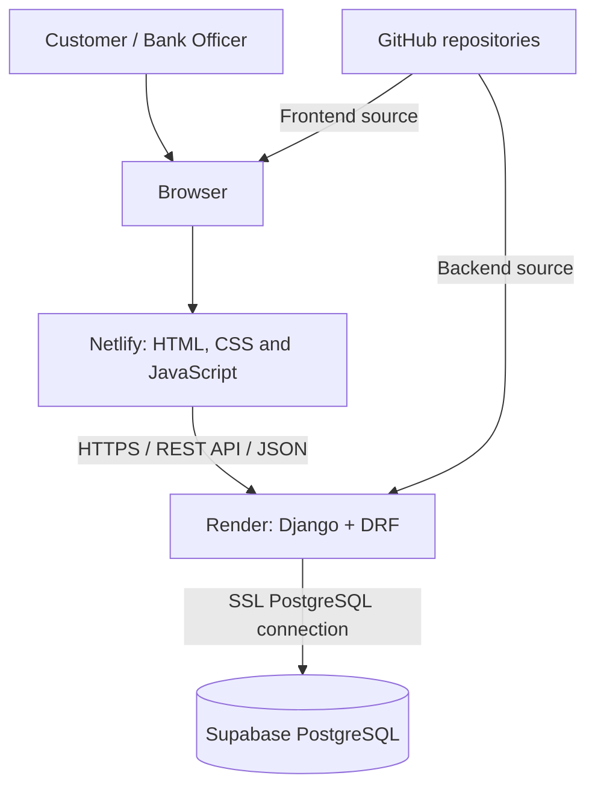
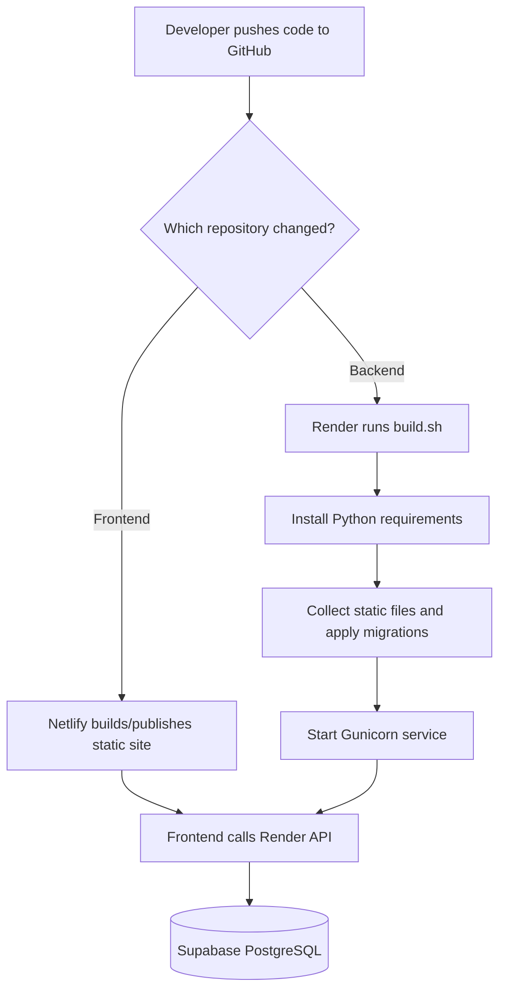

BankEase – Deployment and Integration
Project: BankEase – NextGen Net Banking Application
Project Code: P18
Repository: Bankease-Deployment

This repository contains deployment-related configuration and supporting documentation for the BankEase application. The application code is maintained in two separate repositories: one for the static frontend and one for the Django backend.
Academic demo notice: BankEase demonstrates banking workflows for learning and project evaluation. It is not a real banking service. Transfers, balances, bill payments, loans and investments are simulated; no real money is moved.

System overview
Layer	Technology	Repository / service
Frontend	HTML5, CSS3, Vanilla JavaScript	Bankease-Frontend
Backend API	Python, Django, Django REST Framework, Simple JWT	Bankease-Backend
Database	PostgreSQL	Supabase
Frontend hosting	Static site hosting	Netlify
Backend hosting	Python web service	Render
Local orchestration	Docker Compose	This repository

Architecture

The frontend and backend are deployed independently. The frontend sends API requests to the Render backend, and the backend reads and writes application data in Supabase PostgreSQL.
Contents of this repository
Bankease-Deployment/
├── docs/
│   └── architecture/       # Architecture documentation
├── docker-compose.yml      # Local frontend/backend orchestration
├── render.yaml             # Render Blueprint for the backend service
├── .gitignore
└── README.md
The frontend and backend source code do not live inside this repository; use the links in the related repositories section below.
Related repositories
1. Frontend
2. Backend
3. Deployment – this repository
Local development with all three repositories
The current docker-compose.yml expects the frontend and backend directories to be siblings of the deployment directory and to be named frontend and backend. Clone the repositories using those local directory names:
mkdir BankEase-Workspace
cd BankEase-Workspace

git clone https://github.com/Sadique-Saifi/Bankease-Frontend.git frontend
git clone https://github.com/Sadique-Saifi/Bankease-Backend.git backend
git clone https://github.com/Sadique-Saifi/Bankease-Deployment.git deployment
The resulting structure should be:
BankEase-Workspace/
├── frontend/       # Bankease-Frontend repository
├── backend/        # Bankease-Backend repository
└── deployment/     # Bankease-Deployment repository
1. Configure the backend environment
Go to the backend directory and create .env from .env.example:
cd backend
Windows PowerShell:
Copy-Item .env.example .env
macOS / Linux:
cp .env.example .env
Edit .env with the required Django and Supabase PostgreSQL settings. Do not commit this file.
2. Start the services with Docker Compose
From the deployment directory:
cd ../deployment
docker compose up --build
The checked-in Compose file defines:
- Backend: builds from ../backend using its Dockerfile, maps port 8000, loads ../backend/.env and starts Django's development server on 0.0.0.0:8000.
- Frontend: serves the ../frontend directory read-only through the nginx:alpine image and maps host port 5500 to container port 80.
Open the local frontend at:
http://127.0.0.1:5500
The backend is available at:
http://127.0.0.1:8000
Stop the containers with Ctrl+C, or run docker compose down from the deployment directory.

Note: The Compose setup uses the backend's .env file and the existing Supabase connection settings; it does not define a separate PostgreSQL container. The backend command in the current Compose file uses Django's development server, so this Compose configuration is intended for local development, not production hosting.
Production deployment
Frontend – Netlify
1. Create a Netlify site connected to the Bankease-Frontend GitHub repository.
2. Deploy the main branch.
3. Use the repository root (.) as the publish directory. The frontend is static and does not require a build command in its current form.
4. Configure the frontend JavaScript API base URL to point to the deployed Render backend.
5. Verify that the Netlify site loads and that browser API requests reach the backend successfully.
The frontend repository's netlify.toml specifies the root publish directory and response headers.
Backend – Render
The render.yaml file defines a Render web service with the following configuration:
- Service name: bankease-backend.
- Runtime: Python.
- Region: Singapore.
- Plan: Free (as specified in the current Blueprint file; availability and limits are controlled by Render).
- Source repository: Bankease-Backend, branch main.
- Build command: ./build.sh.
- Start command: gunicorn config.wsgi:application.
- Python version: 3.12.0.
To deploy:
1. Open Render and create or apply a Blueprint using this repository's render.yaml.
2. Confirm that Render is linked to the Bankease-Backend repository and the intended branch.
3. Add the required database and domain configuration values in the Render dashboard.
4. Deploy the service and copy its public HTTPS URL.
5. Set the frontend API base URL to that Render URL.
6. Add the Netlify site origin to the backend CORS configuration, and to CSRF trusted origins where required.
7. Test login and the main API-powered customer/officer workflows.
The Render Blueprint declares these environment settings:
Variable	Purpose
PYTHON_VERSION	Python runtime version
DEBUG	Django debug mode; configured as False
DJANGO_SECRET_KEY	Private Django secret; generated by Render in the Blueprint
DB_NAME	PostgreSQL database name
DB_USER	PostgreSQL username
DB_PASSWORD	PostgreSQL password
DB_HOST	PostgreSQL host
DB_PORT	PostgreSQL port; configured as 5432
DB_SSLMODE	PostgreSQL SSL mode; configured as require
ALLOWED_HOSTS	Hosts accepted by Django
CORS_ALLOWED_ORIGINS	Browser origins allowed to call the API
CSRF_TRUSTED_ORIGINS	Trusted origins for Django CSRF checks

The values marked as externally supplied must be entered securely in Render. Never store actual passwords or secret keys in render.yaml or GitHub.
Deployment workflow

When the GitHub repositories are connected to Netlify and Render with automatic deploys enabled, pushes to the configured branch can trigger a deployment. This describes the hosting-platform deployment workflow; it should not be described as a complete automated test/CI pipeline unless automated test workflows are also configured and running.
Troubleshooting
Problem	What to check
Frontend opens but API calls fail	Confirm the API base URL points to the Render/local backend and inspect the browser Network console.
CORS error in browser	Add the exact frontend origin to CORS_ALLOWED_ORIGINS; check scheme and domain.
CSRF/origin error	Verify CSRF_TRUSTED_ORIGINS and the authentication flow.
Backend cannot connect to PostgreSQL	Recheck DB host, database, username, password, port and required SSL mode.
Render build fails	Check requirements.txt, build.sh, environment variables and Render build logs.
Docker Compose cannot find ../backend or ../frontend	Ensure all three repositories are cloned as sibling folders using the directory names shown above.
Compose cannot read .env	Create backend/.env from backend/.env.example and fill in valid local settings.

Security and operational notes
- Keep .env files, database passwords, API tokens and secret keys out of Git.
- Use a different strong secret for each environment and keep DEBUG=False in production.
- Restrict ALLOWED_HOSTS, CORS origins and CSRF trusted origins to the real deployed domains.
- Use HTTPS for public deployments.
- Rotate any demo credentials that have ever been committed to a public repository. Removing them from the latest README does not erase older Git history.
- Do not enter real customer details or financial credentials into this academic application.
- Free hosting plans may sleep, have resource limits or change over time; check the provider dashboard for current behaviour.
Project scope
This repository documents deployment and local orchestration for an MCA academic project. A real banking deployment would need extensive security engineering, independent audits, monitoring, disaster recovery, regulatory approval, KYC/AML processes and integration with authorized financial infrastructure. BankEase is not production banking software.
